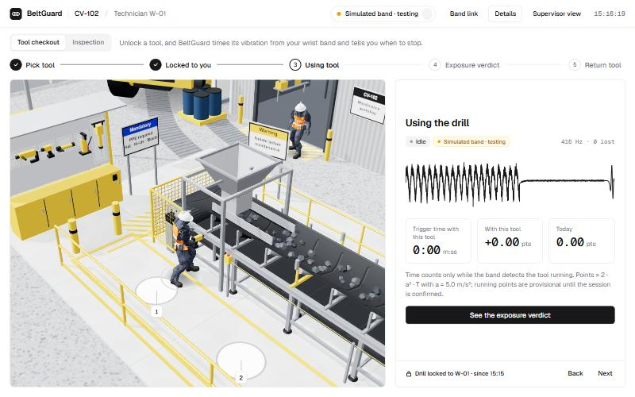
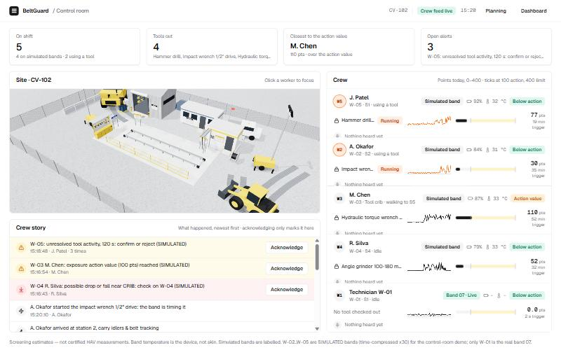

# Vexora

**A Vexo band on the technician's wrist times every power-tool trigger pull, tells them how long they can keep going before the vibration limit, and runs the job by voice.**

<p>


</p>

Built in one day at **VexoHacks** (Y Combinator, San Francisco, 14 November 2026) on the [Vexo Open kit](https://github.com/VexoAI-Org/vexo-open-kit), with team band 07.

## What it does

| | |
|---|---|
| **Tool checkout** | The technician picks a tool (click or voice). It is locked to them, and the 3D conveyor stops with a `LOCKED OUT · W-01` tag. |
| **Tool time from the wrist** | Band 07 streams accelerometer + gyroscope at 416 Hz over Web Bluetooth. A detector times only real tool vibration (walking and waving don't count), and exposure points are computed as 2 · a² · T with the tool's HSE vibration value. |
| **Staged alerts** | Constant vibration builds up amber (5 s), orange (7 s) and red "Exposure exceeded" (10 s) on the screen and on the band's LED. These are demo thresholds that stand in for the action value and the daily limit. |
| **Voice that builds the job** | The band's always-on mic goes to Deepgram. Every sentence is transcribed live, and job steps are extracted as the technician speaks ("isolate and lock out", "guard's off", "new idler fitted"). Doing work before isolation triggers a spoken safety warning. The wake word is "Vexora, …". |
| **Work orders** | "Idler change needed at station three" drafts a work order and a one-page PDF (conveyor, station, part, the quote, job steps, tool exposure). It appears in the supervisor's control room, where **Run work order** hands it to the work-order flow (draft → checks → schedule → create → calendar → verify, in `workorder/`). |
| **Control room** | Five workers on a live 3D site (W-01 is the real band; W-02..W-05 are labelled simulated), speech bubbles over workers, "Within limits: N of 5", and a shift compliance report (CSV / print) for the regulator. |
| **Safety events** | Band free-fall raises "Possible drop or fall: check on W-01" on screen, out loud and in the control room. |

## Run it

```powershell
cd beltguard
python -u backend/app.py            # FastAPI + SQLite on http://127.0.0.1:8765
```

1. Open `http://127.0.0.1:8765/bridge.html` in Chrome, click **Connect band 07** and pick the band. Keep this one tab open; it holds the Bluetooth link and the mic.
2. Technician dashboard: `http://127.0.0.1:8765/`. Control room: `/supervisor.html`. Work-order flow: `/workorder`.

The voice needs a Deepgram key in `beltguard/.env` (`DEEPGRAM_API_KEY=…`, never committed). Full details, architecture, API and tests are in **[beltguard/README.md](beltguard/README.md)**.

## Repository

| Folder | What's in it |
|---|---|
| [`beltguard/`](beltguard/) | The Vexora app (its working folder name): `backend/` (FastAPI, detector, exposure, voice intents, job agent, work-order PDF), `frontend/` (dashboard, control room, Band link, Three.js site), `qa/` tests, `docs/`, `pitch/` |
| [`workorder/`](workorder/) | The work-order flow (Ali): one button runs draft, checks, schedule, create, calendar and verify; mounted into Vexora at `/workorder` |
| [`reference/`](reference/) | The Vexo Open kit, for reference |

## Honest limits

- Exposure is a **screening estimate, not a certified HAV measurement**. Wrist acceleration is never used as the tool's vibration magnitude; points use the tool's published HSE value and the band times the trigger.
- In the demo, a phone on vibrate stands in for a power tool, and the 5 / 7 / 10 s alert thresholds are compressed for show.
- W-02 to W-05 are simulated workers, always labelled as simulated. Vexora drafts work orders; people decide.

## Team

Zubair Zafar · Ali Amjad
