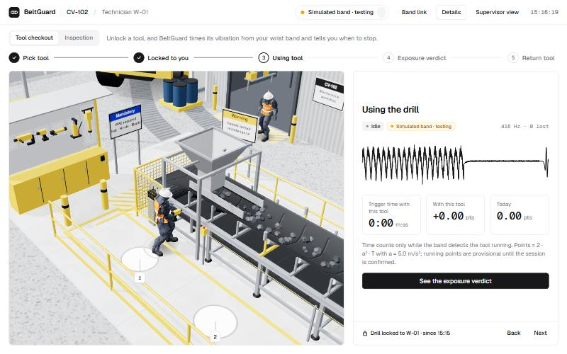
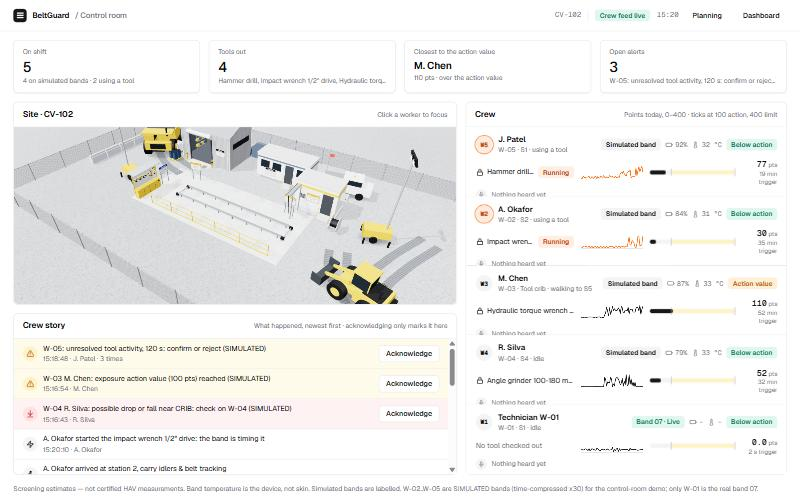
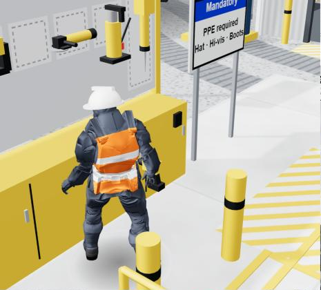

# Vexora

**From tool checkout to exposure verdict, timed by the Vexo band on the technician's wrist.**

<p>


</p>

*Left: the technician dashboard on step 3, "Using the drill". It was captured on the test server with the developers' pretend band, so it shows the amber "Simulated band · testing" chip; on the real band the top bar reads "Band 07 · Live". Right: the supervisor control room. W-01 is the real band 07, and W-02 to W-05 are simulated bands, labelled as simulated on screen.*

Vexora turns the power-tool part of a maintenance shift into a screening-level hand-arm vibration (HAV) record:

- The technician checks a tool out of the crib, by tap or by voice.
- The Vexo band on their tool-hand wrist times every trigger pull.
- Vexora tells them how long they can keep going before the HSE exposure action value and limit value.

Voice with a wake word runs the rest of the shift, hands-free.

Built in one day at VexoHacks (Y Combinator, San Francisco, 14 November 2026) on the official [Vexo Open kit](https://github.com/VexoAI-Org/vexo-open-kit), with team band 07.

## The 60-second story

A maintenance technician walks overland conveyor CV-102 with a Vexo band on the wrist of their tool hand.

1. "**Vexora, I'm at station three.**" Vexora answers out loud: "Station 3, return idlers. Ready when you are."
2. "**Return idler seized.**" A clear defect needs no wake word. Vexora logs it, checks the station in code and drafts a work order for review.
3. "**Vexora, I'm taking the hammer drill.**" In the 3D view the technician walks to the tool wall and picks it up. The card reads "Hammer drill locked to Technician W-01", with about 25 minutes of trigger time left before the action value.
4. Every trigger pull counts. The band feels the tool start and stop at 416 samples a second, and points rise only while the tool runs.
5. "**Vexora, how long can I keep going?**" gets a spoken answer in minutes. At 100 points the screen says "Action value reached: take a break or rotate" and the band flashes red. At 400 it says "Limit reached: stop using vibrating tools today".
6. "**Vexora, done, returning the hammer drill.**" returns the tool with a summary. "**Vexora, idler replaced.**" sends the work order to a supervisor to verify. Vexora never closes work on its own.

In the control room, the supervisor sees the whole crew on one screen: who has which tool, who is close to the action value, and every alert.

## The problem

UK employers must keep each worker's daily hand-arm vibration under control with the HSE points system: **points = 2 × a² × T**. Here *a* is the tool's vibration magnitude in m/s² and *T* is trigger time in hours. **100 points is the exposure action value and 400 points is the exposure limit value** ([HSE](https://www.hse.gov.uk/vibration/hav/assessrisks.htm), [Control of Vibration at Work Regulations 2005](https://www.legislation.gov.uk/uksi/2005/1093/contents/made)).

The weak input is T. When researchers watched workers, they overestimated their own vibration exposure time by a median 2.5× ([Palmer et al. 2000](https://doi.org/10.1136/oem.57.4.237)). On questionnaires the overestimate reached a median 9× ([McCallig et al. 2010](https://doi.org/10.1016/j.apergo.2010.04.002)). So most paper HAV records are guesses.

In the US, NIOSH estimated that about 1.45 million workers use vibrating tools ([NIOSH 89-106](https://stacks.cdc.gov/view/cdc/11176)), and OSHA still has no hand-arm vibration limit ([MEMIC](https://memic.com/workplace-safety/safety-net-blog/havs-and-the-have-nots)).

The products that exist add dedicated hardware:
- a wrist unit that reads an RFID tag fitted to every tool (Reactec HAVwear)
- a sensor glove (HAV-Sentry)
- a separate wearable (spacebands)

Vexora starts the exposure clock at the tool checkout and uses the band the technician already wears.

## Features

### 1. Tool checkout → live verdict (the main flow)
The technician dashboard (`/`) walks through five steps, one at a time:

| Step | What happens |
|---|---|
| **1 Pick tool** | **Start** walks the 3D worker to the tool wall. Pick from the crib, on screen or on the 3D wall, or say "Vexora, I'm taking the hammer drill". Each card shows the tool's magnitude and source: drill 5, hammer drill 11, impact wrench ½" 5, angle grinder 7, power jack 2.5 and breaker hammer 14 m/s², with more tools under **More tools**. |
| **2 Locked to you** | "Hammer drill locked to Technician W-01", with the time, the magnitude, the points per hour and the minutes to the action value. Only this person's trigger time counts toward this checkout. |
| **3 Using tool** | The live wrist signal and the detector state. **Trigger time** counts only while the band detects the tool running. Points show as "provisional" until the session is confirmed. |
| **4 Exposure verdict** | One state: **Within the safe limit**, **Action value reached: take a break or rotate**, or **Limit reached: stop using vibrating tools today**. It comes with a 0–400 bar marked at 100 and 400, and the minutes left to each. |
| **5 Return tool** | A summary of the trigger time and points with this tool and each session. Returning closes the checkout, and today's points stay on the technician's record. |

The tool is always known from the checkout, never guessed from motion.

### 2. Voice, with a wake word
The band's mic is always on while it's connected. Deepgram transcribes every sentence, and the laptop speaks Vexora's replies.

- **Commands start with "Vexora"** (Deepgram's "Belt guard" and "Hey Vexora" also work):
  - "I'm at station three"
  - "I'm taking the hammer drill"
  - "how long can I keep going?"
  - "done, returning the hammer drill"
  - "idler replaced", which sets the work order to *awaiting supervisor verification*
  - "conveyor isolated", which is logged as a claim that an authorized person must verify
  - "taking a break"
  - "yes" or "no" to answer a question
- **A clear defect report needs no wake word.** A part plus a problem, such as "Return idler seized", becomes a defect and a work-order draft.
- **Everything else is chat.** Every sentence is stored with what Vexora did with it (`GET /api/transcripts`). Chat is marked ignored and never acted on or answered.
- The intent parser is deterministic code (`backend/intents.py`) and needs no API key. If it can't pin down a station or a tool, it asks instead of guessing.

### 3. Band events
- **Double-tap** confirms a session the band was unsure about. Vexora asks "Was that Hammer drill, 20 seconds? Say yes or no, or double-tap to confirm."
- **Free-fall** raises a safety alert, "Possible drop or fall near S3 Return idlers: check on W-01", with a red banner on the dashboard. Vexora only reports it; a person must check.
- **The LED flashes red for 4 seconds** when the day crosses 100 or 400 points. The band locks its LED while the mic is on, so Vexora pauses the audio, flashes, then resumes listening.

### 4. Supervisor control room (`/supervisor.html`)
- Crew KPIs: on shift, tools out, closest to the action value, open alerts.
- The 3D site with every worker at their station and their tool in hand.
- A card per worker: tool and since when, live sparkline, trigger time, 0–400 bar, verdict, band battery and device temperature, and the last answered voice exchange.
- A crew story feed with alerts to acknowledge.
- **One real band and four simulated ones.** W-01 is the real band 07. W-02 to W-05 are simulated bands:
  - They carry a "Simulated band" chip and the source `sim`.
  - They run 30× faster than real time, so a short demo shows a shift's worth of exposure.
  - They live in memory only, so nothing about them is ever written to the database.
  - Their spoken lines go through the same intent parser.

  The repair planner from earlier builds lives on at `/planning.html`.

### 5. Realistic 3D site (Three.js)
- **The site:** conveyor CV-102 with five stations, on a gravel site with a workshop, MCC room, light towers, a haul truck, a wheel loader working a stockpile, safety signage, walkways and dust off the discharge.
- **The technician:** a rigged worker in hi-vis who walks to the tool wall, picks the checked-out tool, walks to the station and holds the tool while it runs. The belt stops while a tool is in use.
- **The crew:** in the control room the simulated crew appear too, with tinted vests and point badges marked SIM.
- **The camera** flies in once at load and then rests.



*The technician at the tool wall. A dashed outline marks the slot of a tool that's checked out.*

### 6. Inspection: defects and work orders (Inspection tab)
- A spoken or typed report becomes a structured defect. **Code, not the model, checks the station** against CV-102's five real stations. A missing, unknown or contradictory station gets a question back, never a guess.
- Every work-order draft says isolation must be verified by an authorized person.
- When an OpenAI key is set, extraction uses OpenAI structured output (the kit's `ai.extract`, strict schema, storage off). Otherwise a rules extractor does it, with source `rules`.

## Why the band is essential
- **Take the band off and T goes back to a guess**, with the same 2.5–9× error. The wrist of the tool hand moves with the tool from trigger pull to release; a phone in a pocket feels neither.
- **Hands are busy and gloved.** Voice, the wake word and the double-tap replace the clipboard and the tablet.
- **No tool tags.** The tool comes from the crib checkout, not from an RFID tag fitted to every tool.
- **It's on the body.** The fall alert and the red flash at the limit happen on the person, wherever they are on the conveyor.

## Architecture

```
 Vexo band 07 (tool-hand wrist)
 accel + gyro 416 Hz (16 g / 2000 dps) · mic (16 kHz Opus) · double-tap, free-fall · LED
        │ Bluetooth LE                                    │ USB (optional)
        ▼                                                 ▼
 Band link tab  frontend/bridge.html                backend/band.py
 kit JS SDK (Chrome Web Bluetooth)                  official vexo_open Python SDK
 voice.js: band mic → Deepgram nova-3                     │
        │ /ws/ingest (motion, events)                     │
        │ /api/report (every sentence)                    │
        └──────────────────────┬──────────────────────────┘
                               ▼
               backend/app.py   FastAPI + uvicorn on 127.0.0.1:8765, asyncio event hub
   ┌──────────────┬────────────┼──────────────┬──────────────┬──────────────┐
   ▼              ▼            ▼              ▼              ▼              ▼
 detector.py   exposure.py   intents.py   inspection.py   planner.py     fleet.py
 tool running  2·a²·T,       wake word,   defect + WO,    exposure-      W-01 real +
 start/stop,   100 / 400,    commands,    code-checked    aware repair   W-02..05
 confidence    minutes left  replies      station         planning       SIMULATED
                               │
                               ▼
               backend/db.py   SQLite: every row has id, ts, source
                               │  WS /ws  ·  REST /api/*
          ┌────────────────────┼─────────────────────┐
          ▼                    ▼                     ▼
 Technician dashboard   Control room           Planning
 /  (app3.js,           /supervisor.html       /planning.html
 model3d.js 3D,         crew, 3D site,
 browser speech)        crew story, alerts
```

- Trigger time comes from the band's own sample clock (`motion.t`), never sample counts, because real rates drift: 416 Hz runs at 407–423 Hz. Lost samples are counted from `motion.n`.
- The band holds one Bluetooth link. The Band link tab owns it, and the dashboard can reload freely without dropping the band.
- With audio streaming, motion drops itself to 208 Hz if 416 Hz starts losing samples.

## Run it (Windows, PowerShell)

You need Python 3.11 or newer (built on 3.13), Chrome (for Web Bluetooth), and your own team's Vexo band. **Never connect to another team's band.**

```powershell
cd beltguard
python -m pip install "./vexo-open-kit/python[ble]"      # official Vexo Open SDK + bleak
python -m pip install -r backend/requirements.txt         # fastapi, uvicorn, websockets, numpy, openai
Copy-Item .env.example .env                               # then fill it in
```

`.env` (git-ignored, never commit it):

| Key | Needed for |
|---|---|
| `DEEPGRAM_API_KEY` | Voice. The Band link tab fetches it from `GET /api/voice/config`, which answers only to the laptop itself (loopback). |
| `OPENAI_API_KEY` | Optional. AI defect extraction; without it, the rules extractor runs. |
| `VEXO_BAND` | Your band number (ours is 7). |

Start the backend, then open the dashboard:

```powershell
python -u backend/app.py          # or .\backend\run.ps1
```

1. Open **http://127.0.0.1:8765/** in Chrome.
2. **Connect the band:** click **Band link** in the top bar, then **Connect band 07**, and pick your band in Chrome's Bluetooth dialog. Keep that tab open. Voice starts by itself, and the Inspection tab says **Listening on band 07**. Over a USB cable, the backend finds the band by itself (USB is searched by default; add `--ble` to also search Bluetooth from Python).
3. **Let it talk:** click once anywhere on the dashboard (Chrome only speaks after a click). The **Speak Vexora's replies aloud** switch is in **Details**.
4. Open the control room at **http://127.0.0.1:8765/supervisor.html**.
5. Start a clean shift with `POST /api/tool/return` (if a tool is out), then `POST /api/reset`.

**For developers only:** `python -u backend/app.py --sim` runs the kit's pretend band. Everything is labelled SIMULATED, and the normal server refuses to switch to simulation. `python qa/isolated_server.py 8799 --sim` starts a throwaway server on a copy of the database, for UI checks that must not touch the real shift.

### API

| Method | Path | Purpose |
|---|---|---|
| GET | `/api/state` | full snapshot: stations, tools, assignment, verdict, sessions, exposure, defects, work orders, timeline |
| GET | `/api/health` | connection, link, rate, lost samples, loaded modules |
| GET | `/api/fleet` | control-room crew (W-01 real, W-02..05 simulated) |
| GET | `/api/transcripts` | every sentence heard and what Vexora did with it |
| GET | `/api/samples` | the newest real band readings from SQLite |
| POST | `/api/tool/checkout` `{"tool_id":"hammer_drill"}` | lock a tool to the technician |
| POST | `/api/tool/return` | return it (closes any running session first) |
| POST | `/api/report` `{"text":"..."}` | a typed sentence, through the same path as voice (typed text needs no wake word) |
| POST | `/api/tool_session/{id}/confirm` `{"confirmed":true}` | confirm or reject an unsure session |
| POST | `/api/station` `{"station_id":"S3"}` | set the current station |
| POST | `/api/repair/plan` | exposure-aware recommendation for a planned job |
| POST | `/api/reset` | start a new shift |
| POST | `/api/rate` `{"rate":208\|416,"sensors":"both"}` | change the motion rate (only rates the band allows) |
| POST | `/api/band/connect` `{"mode":"band"\|"usb"\|"off"}` | switch the Python link |
| WS | `/ws` | live motion, activity, verdict (1/s during use), assistant replies, transcripts, events, fleet, snapshots |
| WS | `/ws/ingest` | the Band link tab's stream into the backend |

### Tests

```powershell
python backend/test_brain.py       # HAV maths, tool profiles, defect extraction + station checks, planner
python backend/test_detector.py    # tool-use detector on synthetic walking, gestures, tools, gaps
python backend/test_intents.py     # wake word and voice commands
python qa/voice_e2e.py             # voice end to end on a temporary copy of the database (no band needed)
```

## Honesty and limits

- **A screening estimate, not a certified HAV meter.** Points use the checked-out tool's reference magnitude times the trigger time the band detected. ISO 5349 measures vibration at the hand–tool interface. The band times trigger use; it never measures vibration at the hand, and the wrist accelerometer is never converted into an exposure value.
- **The band never names the tool.** The checkout does. Sessions the band is unsure about stay "unresolved" until the technician confirms or rejects them, and a rejected session adds nothing.
- **AI drafts, people decide.**
  - Vexora never authorizes isolation, never closes or verifies a work order and never reassigns anyone.
  - "Job done" only moves a work order to awaiting supervisor verification.
  - Isolation claims are logged for an authorized person to verify.
  - The fall alert only reports.
- **Code, not the model, decides the station.**
- **Simulated means labelled.** The control room's W-02 to W-05 are simulated, 30× time, in memory only and marked "Simulated band". The technician dashboard shows a "Simulated band · testing" chip whenever it runs on the developers' pretend band. Everything about W-01 comes from the real band 07.
- **Always listening has a cost.** While the band is connected, its audio streams to Deepgram, and every sentence is stored, chat included (marked ignored). A real deployment would need consent and data-retention rules. Only defect reports go to OpenAI, and only when a key is set.
- **Reference magnitudes, not measurements.** *a* is HSE's recommended initial value for the tool type, not the specific tool. Use the tool's declared value or an on-tool measurement when one exists.
- **Not yet tested on real power tools.** The stage demo uses a phone on vibrate as a stand-in, and says so.
- **One seeded conveyor (CV-102, five stations) and one real worker.** The laptop speaks the replies (the band has no speaker) and bridges Bluetooth. There's no phone app or cloud yet.

## Tool profiles

[backend/tool_profiles.json](backend/tool_profiles.json) stores each magnitude with its source. Most are HSE's recommended initial values from [Table 1 of its vibration risk assessment guidance](https://www.hse.gov.uk/vibration/hav/assessrisks.htm).

| Tool | a (m/s²) | HSE range | Minutes to 100 points | Lower-vibration alternative |
|---|---|---|---|---|
| Drill (rotary, standard bit) | 5 | 2–5 | 120 | magnetic-base (rig-mounted) drill |
| Hammer drill | 11 | 7–13 | 25 | rig-mounted drilling or clamp-on fixings |
| Impact wrench ½" drive | 5 | 3–6 | 120 | non-impact torque wrench (≤ 2.5) |
| Angle grinder 100–180 mm | 7 | 3–10 | 61 | hydraulic nut splitter |
| Power jack / belt lifter (hydraulic) | ≤ 2.5 | — | 480 | not in HSE Table 1; 2.5 is a cautious upper bound ([Safe Work Australia](https://www.safeworkaustralia.gov.au/system/files/documents/1703/guidetomeasuringassessinghandarmvibration.pdf)) |
| Breaker hammer | 14 | 7–18 | 15 | remote-controlled demolition machine |
| Impact wrench 1" drive | 10 | 7–11 | 30 | hydraulic torque wrench |
| Needle scaler (non vibration-reduced) | 19 | 12–26 | 8 | vibration-reduced needle scaler (7) |
| Chipping hammer (stone, concrete, rust) | 20 | 11–22 | 8 | water/air lance or an engineering fix |
| Phone on vibrate (DEMO stand-in) | 5 | — | 120 | uses the ½" impact wrench's value; its own vibration isn't used |

Minutes to 100 points = 100 / (2 × a²) hours, rounded. HSE warns that manufacturers' data can underestimate workplace vibration.

## Repository map

```
beltguard/
  README.md              this file
  .env.example           key names (copy to .env)
  backend/               FastAPI app, band bridge, SQLite, detector, exposure, intents, inspection, planner, fleet, tests
  frontend/              technician dashboard (index.html), Band link (bridge.html), control room (supervisor.html),
                         planning (planning.html), 3D (model3d.js); vendor/ holds unchanged kit JS (Bluetooth SDK, Deepgram link)
  demo/DEMO_SCRIPT.md    2-minute live run sheet, fallbacks, judge questions, video shot list
  pitch/                 Devpost submission text, requirements, release checklist
  docs/img/              screenshots for this README
  qa/                    end-to-end checks, isolated test server, UI screenshots
  tools/                 detector labelling and analysis scripts
  ops/                   build heartbeat log and band probe from the hackathon
  data/                  SQLite database and raw band recordings (git-ignored)
  vexo-open-kit/         unchanged copy of github.com/VexoAI-Org/vexo-open-kit (MIT)
```

## Credits
- **[Vexo Open kit](https://github.com/VexoAI-Org/vexo-open-kit)** by Vexo AI (MIT licence): the band, its Bluetooth contract, the Python and JavaScript SDKs, and the kit's speech and AI helpers. The kit is vendored unchanged in `vexo-open-kit/` and `frontend/vendor/`.
- [three.js](https://threejs.org/) r160 (MIT) and its example Soldier model, loaded from the three.js repository.
- [Deepgram](https://deepgram.com/) nova-3 for speech-to-text, and [OpenAI](https://openai.com/) for optional defect extraction.
- [Geist](https://vercel.com/font) fonts (SIL Open Font License).
- Vibration data from the UK Health and Safety Executive, and the research cited below.
- Built at VexoHacks with [Claude Code](https://claude.com/claude-code).

## Sources
- HSE, [Vibration risk assessment](https://www.hse.gov.uk/vibration/hav/assessrisks.htm): exposure points, 100/400 points, Table 1 tool magnitudes.
- [The Control of Vibration at Work Regulations 2005](https://www.legislation.gov.uk/uksi/2005/1093/contents/made): EAV A(8) 2.5 m/s², ELV A(8) 5 m/s².
- Palmer KT et al., [Validity of self reported occupational exposures to hand transmitted and whole body vibration](https://doi.org/10.1136/oem.57.4.237), Occup Environ Med 2000;57:237–241. Median overestimate of HAV exposure time 2.5× (IQR 1.6–5.9).
- McCallig M et al., [Evaluating worker vibration exposures using self-reported and direct observation estimates of exposure duration](https://doi.org/10.1016/j.apergo.2010.04.002), Applied Ergonomics 2010;42(1):37–45. Questionnaire HAV times a median 9.0× observed.
- NIOSH, [Criteria for a Recommended Standard: Occupational Exposure to Hand-Arm Vibration](https://stacks.cdc.gov/view/cdc/11176), DHHS (NIOSH) Publication No. 89-106, 1989.
- MEMIC, [HAVS (and the Have Nots)](https://memic.com/workplace-safety/safety-net-blog/havs-and-the-have-nots): no OSHA hand-arm vibration standard.
- Safe Work Australia, [Guide to measuring and assessing workplace exposure to hand-arm vibration](https://www.safeworkaustralia.gov.au/system/files/documents/1703/guidetomeasuringassessinghandarmvibration.pdf): treat declarations below 2.5 m/s² as 2.5.
- Incumbents: [Reactec HAVwear with RFID tool tags](https://www.rfidjournal.com/?p=67649), [HAV-Sentry](https://hav-sentry.com/), [spacebands](https://www.safetyhealthwellbeing.live/press-releases/spacebands-wearables-that-control-havs-and-noise-exposure-and-cut-costs).
